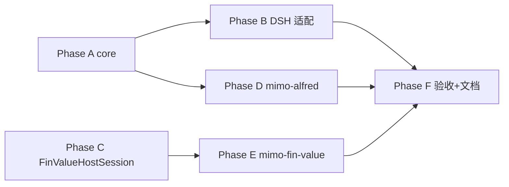

# Alfred Multi-Host Core（DSH + MiMo Desktop）

## Report

**Baseline refreshed (2026-09-20 Desktop 修订)** — 目标宿主明确为 **MiMo Desktop**（Electron 应用，内嵌 MiMoCode 引擎），不是把 CLI TUI 当主交付面。

**Phase D 补强（2026-09-20）** — 模板文件化（`templates/**.tmpl`）、`-GlobalSkills` 实装、`.alfred-install.json` 回执、hook 改为 `session.userQuery.pre` + `messages.transform`、安装/卸载/幂等 6 测通过。

- 相对 2026-09-14：拆开 Desktop vs CLI；skills 安装根改为 Desktop 实际扫描的 MiMoCode 路径（**不是** `~/.claude/skills`）；激活语义收紧为「项目工作区启用才挂载」。
- **2026-09-20 增补：** 明确「抽象胶水层」——`AgentHost` 接口 + `AlfredControlRuntime` 装配进 `alfred-core/host`；`dsh-alfred` / `mimo-alfred` 只实现接口，未来新 agent 不复制路由/handler 业务。
- **2026-09-20 产品模型：** ALF 定位为「嵌进宿主的 **Skill 包 + 工具运行时**」：**单命令安装器**、**宿主配置 + 环境变量**、`.agents/alfred.json` 只留 `enabled`；不是第二套独立 Agent 控制台。
- **2026-09-20 本版禁用 persona：** 会话启动 persona 注入、称呼偏好工具与 `alfred_set_preferred_address` **全部移出本版交付**（含 Desktop 与 multi-host core 接线）；DSH 现网若已有 persona，重构后默认关闭，待后续单独设计再开。能力发现/路由/领域工具不受影响。
- 命名冲突提醒：`.worktrees/mimo-gpt-oauth-plugin/packages/mimo-alfred` 是 **ChatGPT OAuth workaround**，与本规格的 ALF MiMo 适配包同名不同物；实施时 ALF 侧包名保持 `packages/mimo-alfred`，OAuth 插件不得占用该 workspace 名，或改名为 `mimo-gpt-oauth-plugin`。

## [S1] Problem

当前 ALF 控制面（`packages/dsh-alfred`）与 Fin Value DSH bundle（`repos/fin-value/packages/dsh-fin-value`）把 **host-agnostic 逻辑** 和 **DeepSeek Harness Cordis 适配** 写在同一包内：

- 控制面：能力目录、关键词路由、显式 `/alf` 触发、激活配置、称呼偏好（含 turn 授权）、`alfred.ps1` 能力探针、persona/路由指令文案。
- 领域：Fin Value 行情/估值/持仓/策略直存/确认式账本/资料库服务几乎不依赖 DSH，但工具注册、session/turn 提取、顶层用户判断仍散落在 `dsh-fin-value/src/index.ts`。

用户希望同一套底层也能服务 **MiMo Desktop**，而不是复制一份领域实现。需要抽出共享核心与显式 host 接口，DSH 与 MiMo Desktop 只做薄适配。

### Desktop 与 CLI 必须区分（本规格的硬边界）

| 维度 | MiMo Desktop（本规格目标） | MiMo Code CLI / TUI（非第一期交付面） |
|------|---------------------------|--------------------------------------|
| 产品形态 | Electron 桌面应用；内嵌 MiMoCode 引擎 | 终端 `mimo` TUI |
| 会话类型 | ① 编码会话（有 **project chip**，在项目目录内跑引擎）② **日常闲聊**（内容路由直连模型，**不**跑编码引擎）③ Office 文件助手 ④ 侧边聊天 / 消息分支 / Automations 独立快照 | 单一 TUI 会话；`Tab` 切 primary agent |
| tools/hooks | 仅编码会话可加载项目 `.mimocode/tools`、`.mimocode/hooks`（引擎扫描） | 同左，且是 CLI 文档的主路径 |
| Skills 扫描根 | **仅** MiMoCode 根：`~/.config/mimocode/skills`、`<project>/.mimocode/skills/`；**不扫描** `~/.claude/skills` 等 brand roots | 引擎同样读 MiMoCode 根；CLI 用户可另配 `skills.paths` |
| 项目 cwd | Composer 上 **project chip** 为权威；无 chip 的会话用默认 session 目录 | `cwd` 即终端当前目录 |
| 权限 UI | 桌面确认卡（Allow once / Always allow / Reject） | TUI permission |
| MCP | Settings → MCP；变更对**新会话**生效，不热更当前会话 | `mimocode.json` `mcp` |
| 第一期 ALF 范围 | **只**覆盖「编码会话 + 项目已启用 ALF」 | 不作为验收主路径；能力可顺带兼容但不承诺 |

**明确不覆盖（Desktop）：** 日常闲聊、Office 助手、无 project chip 的默认目录会话——这些路径无法可靠注册 `alfred_*` tools 或 pre-query 路由 hooks。用户若在闲聊里问「港股/能力」，ALF 不保证介入；应在编码会话中使用。

### 相对初版的基线变化（必须纳入实现）

| 变化 | 对 multi-host 的影响 |
|------|----------------------|
| ALF 已是 **Standard 内调度入口**，不再是独立 preset | `isExcludedMode` 只排除 Minimal/plan 等；不能再假设 `agentPreset=alfred` |
| 策略改为 `fin_value_save_portfolio_strategy` 一次直存 | MiMo Fin Value 适配不再暴露策略 prepare/commit；成交/初始持仓仍 prepare→下一轮 commit |
| 研究归档路由已带只读 prepare 提示文案 | `routingInstruction` 必须原样进入 core，DSH/MiMo 共用 |
| 称呼保存绑定 turnId（**已废弃，本版禁用**） | `turnId` 仍保留给未来授权能力，但不再实现称呼表 |
| session repair / preview 工具已存在 | 仍属 DSH 运行时维护，**不**进 MiMo 第一期 |
| knowledge-base-kit 新增 `capability-status` | 可选：作为知识域 runtime visibility 的只读旁路；不替代 ALF probe |

## [S2] Design

### 产品模型：ALF 是「嵌进宿主 Agent 的插件包」，不是第二套 Agent

用户心智应对标「给 VS Code 装扩展 / 给 Claude 装 skill+MCP」，而不是「再启动一个 Alfred 应用」：

```text
┌──────────────────────────────────────────────┐
│  ALF Pack（版本化交付物，可重复安装/卸载）      │
│  ┌────────────┐  ┌─────────────────────────┐ │
│  │ skills/*   │  │ tool runtime            │ │
│  │ 渐进披露MD │  │ alfred_* / fin_value_*  │ │
│  │ + locales  │  │ （宿主 tools 或 MCP）    │ │
│  └────────────┘  └─────────────────────────┘ │
│  manifest：能力目录、关键词、mutation 策略      │
└───────────────────┬──────────────────────────┘
                    │ 一条安装命令
        ┌───────────┴───────────┐
        ▼                       ▼
  DSH bundle 安装         MiMo Desktop 安装
  (现有 install-dsh)      (新 install-desktop)
        │                       │
        └───────────┬───────────┘
                    ▼
            宿主自己的会话/工具系统
```

| 角色 | 职责 | 用户要做什么 |
|------|------|----------------|
| **Pack** | 唯一真相源：skills 正文、工具实现、能力清单 | 不手改生成物 |
| **Installer** | 一条命令：检测宿主 → 落盘到宿主扫描位置 → 打印还缺的配置 | 跑一次命令 |
| **Host** | DSH / MiMo Desktop… 负责加载 skills/tools、开会话 | 在宿主里正常用 |
| **Config** | 少数键进宿主配置；密钥与机器路径走环境变量 | Settings / env 各设一次 |
| **Enable** | 项目或用户 `enabled`；决定「这个工作区要不要 ALF」 | 写 `.agents/alfred.json` 或安装器 `-Enable` |

**和「自建控制面」的差别：**

- 不向用户暴露第二套独立「Alfred 控制台」作为主入口；能力状态仍通过宿主内 `alfred_capabilities` / 宿主 Plugins 列表看到。
- 安装/升级/卸载都走 **同一 installer 幂等覆盖**，禁止用户长期手改 `.mimocode` 生成文件。
- 配置能进宿主就进宿主（MCP 行、`cordis.patch.yml`、Desktop Environment），避免再维护一份平行配置中心；`.agents/alfred.json` **只保留 `enabled`**（+ 可选 `schemaVersion`），其余不扩。

### 同类产品常见安装形态（选型依据）

| 形态 | 优点 | 对 ALF 的适用 |
|------|------|----------------|
| MCP server | 宿主一行配置、工具与项目解耦 | 适合**全局工具**；难表达「仅某项目启用」与 turn 级路由 |
| 宿主 Plugin/marketplace | 可发现、可开关 | Desktop Plugins 主要管 **skills**；工具仍要 MCP 或 `.mimocode/tools` |
| 项目级 skills+tools 落盘 | 与 cwd/激活强一致，权限边界清楚 | **Desktop 第一期采用**（编码会话+项目启用） |
| npx 交互向导 | 新手友好 | 作为 installer 的 `-Interactive` 可选，非默认 |

### 目标形态（实现包结构仍服务上述模型）

```text
packages/alfred-core
  ├─ domain/*          纯业务（catalog/routing/activation/preferences/probe/handlers）
  └─ host/*            抽象胶水层：AgentHost 契约 + AlfredControlRuntime 装配
packages/dsh-alfred    DshAgentHost：只实现 AgentHost + Cordis 安装
packages/mimo-alfred   MimoDesktopAgentHost：只实现 AgentHost + 项目 .mimocode 安装
未来 XxxAgentHost      再接新 agent 时只新增一个 host 实现，不改 domain
```

所有者不变：ALF 拥有调度、能力发现（**本版不含 persona/称呼**）；Fin Value 拥有港股领域与确认写入；knowledge-base-kit 保持通用；umbrella 不吸收领域实现。

**本版明确关闭 persona 子系统**（见 Out of Scope）：不注入会话 persona、不读/写称呼偏好、不注册 `alfred_set_preferred_address`。`HostSessionContext.turnId` 仍保留（服务未来授权类能力，以及与 turn 门禁一致），但不再绑定称呼授权表。

### 抽象胶水层（用户核心诉求）

**问题：** 若只有「domain + 两个各自为政的 adapter」，第三家 agent 还要再抄一遍「怎么注册工具、怎么在用户轮次前插指令、怎么算 visibility」。

**做法：** 胶水也分「契约 / 装配 / 平台细节」三层——

```text
┌─────────────────────────────────────────────────────────┐
│  domain（alfred-core）  业务：算路由、拼指令、查能力…      │
└───────────────────────────▲─────────────────────────────┘
                            │ 调用
┌───────────────────────────┴─────────────────────────────┐
│  AlfredControlRuntime（抽象胶水装配，仍在 core）          │
│  - onSessionStart(session) → 本版恒返回 null（persona 关） │
│  - onDirectUserTurn(session, text) → 路由指令文本|无     │
│  - buildCapabilityView(session, visibility)              │
│  - tool handler（capabilities）；address handler 已移除    │
│  - 不 import 任何 Cordis / .mimocode API                 │
└───────────────────────────▲─────────────────────────────┘
                            │ 实现接口
        ┌───────────────────┼───────────────────┐
        │                   │                   │
   DshAgentHost      MimoDesktopAgentHost   FutureAgentHost
   Cordis 注册        生成/加载 .mimocode    …
   agent.inject       hooks 注入
   ctx.tools/skills   项目 skills 目录
```

```ts
/** 每个宿主必须实现的最小胶水接口（TS interface，不强制 class 继承） */
export interface AgentHost {
  readonly id: string // 'dsh' | 'mimo-desktop' | ...
  /** 把 ALF 工具挂到本宿主（DSH: tools.register；Desktop: 安装器写 .mimocode/tools） */
  registerAlfTools(runtime: AlfredControlRuntime): void | Promise<void>
  /** 挂 dispatcher / 领域 skills（路径与 locales 由宿主决定） */
  registerAlfSkills(runtime: AlfredControlRuntime): void | Promise<void>
  /** 当前会话是否应视为「已启用 ALF 的顶层用户编码会话」 */
  resolveSession(raw: unknown): HostSessionContext | null
  /** 运行时可见的 skill/tool 名，供 capability view 合并 */
  visibility(session: HostSessionContext): HostVisibility
  /** 在本轮模型上下文追加一条 ALF 指令（不落盘为用户消息语义）。本版仅用于 routing，不用 persona。 */
  injectInstruction(session: HostSessionContext, text: string, form: 'routing'): void
}
```

约束：

- `AlfredControlRuntime` **禁止**依赖宿主 SDK；宿主 **禁止**内联复制 routing/handler 业务。
- 新 agent = 实现 `AgentHost` + 安装脚本；domain 与 runtime 零改动（除非该宿主缺能力导致 HostVisibility 降级）。
- Desktop 的「注册」是 **安装期代码生成/落盘**，DSH 的「注册」是 **进程内 API**；两者都实现同一 `AgentHost`，不要求同一机制。
- 未来若出现「无 pre-turn 钩子」的宿主，`injectInstruction` 可 no-op，capability 仍可只读；安全下限仍是提示不授权写入。

### HostSessionContext（宿主必须提供的会话事实）

```ts
export interface HostSessionContext {
  /** 确认令牌绑定的稳定会话 id */
  sessionId: string
  /** 本会话内可比较、单调的用户轮次；commit 必须 > prepare 的 turn */
  turnNumber: number
  /** 当前直接用户消息 id；本版仅作稳定 turn 标识（预留后续授权类能力） */
  turnId: string
  /** 用于日志与调试，不参与安全判断 */
  agentId: string
  /** 顶层直接用户会话；subagent/fork 非顶层则 false */
  isTopLevelHuman: boolean
  /** 排除模式（DSH minimal、MiMo plan 等写敏感模式） */
  isExcludedMode: boolean
  /** 激活解析用 cwd */
  cwd?: string
  /** preset 或 primary agent 名，仅展示与 actionability */
  modeName: string
}
```

契约：

- `turnNumber` 必须在同一 `sessionId` 内严格递增；写入类工具在 `commit` 时要求 `current.turnNumber > prepare.turnNumber`。
- `turnId` 在同一 turn 内稳定；本版无称呼授权表，字段预留给后续能力。
- `isTopLevelHuman === false` 或 `isExcludedMode === true` 时，禁止资料库 commit、账本 prepare/commit（**不含**称呼保存——已下线）。
- 策略 `save_portfolio_strategy` 只要求顶层直接用户明确请求，**不**走跨轮确认令牌（已在 fin-value 落地）。
- 宿主不得把 subagent 的 `sessionId` 映射为父会话 id，除非该宿主能保证确认语义仍安全。

### HostVisibility（运行时可见性）

```ts
export interface HostVisibility {
  listVisibleSkills(): Promise<Array<{ name: string }>>
  listVisibleTools(): Array<{ name: string }>
}
```

DSH：`ctx.skills.list` + `ctx.tools.schemas(agent)`。
MiMo Desktop：项目 `.mimocode/skills/<id>` 已安装名 + 当前编码会话已注册 tool id；日常闲聊无 visibility 概念（直接不进入 ALF）。不可用则返回空并降级为 `not-visible`。
（可选后续）knowledge 域可合并 `kb.ps1 capability-status -Json`；该接口刻意不含路径且 `runtimeEntryPoints=not-assessed`，不得假装已加载。

### ALF core 对外能力

从 `dsh-alfred` 迁出并稳定导出（domain + host 装配）：

| 导出 | 职责 |
|------|------|
| `catalog` / `loadRoutes` / `matchRoutes` | 能力路由（含 research-archive、strategy-write 现行 keywords/tools） |
| `parseAlfredInvocation` / `routeForTurn` / `routingInstruction` | 显式调用与主动路由（含归档 prepare 指令） |
| `resolveAlfredActivation` | 项目/用户 `.agents/alfred.json` |
| `readPreferences` / `writePreferredAddress` | **本版不迁入 multi-host 交付面**；源码可暂留 dsh-alfred 但 runtime 默认不调用 |
| `CapabilityProbe` | `alfred.ps1 capabilities -Quick -Json` |
| `buildPersonaInstruction` | **本版删除或恒空实现**，待 persona 重设计后再加 |
| `buildCapabilityView` | 指令与能力视图 |
| `AlfredControlRuntime` | 抽象胶水装配：统一调用 domain，不绑宿主 |
| `AgentHost` 类型 | 宿主必须实现的接口 |
| `handleCapabilities` | 纯 tool handler（供 runtime / 宿主包装） |

工具 handler 签名统一为：

```ts
type ToolHandler<A, R> = (args: A, session: HostSessionContext, signal?: AbortSignal) => Promise<R>
```

不依赖 Cordis `Context`、`defineTool` 或 `exec.agent` 形状。

### 激活与可见性语义（双宿主一致；Desktop 更严）

- 激活开关仍以 `<project>/.agents/alfred.json` 与 `~/.agents/alfred.json` 为准；MiMo Desktop **不**另设第二套 enable 文件。
- **Desktop 第一期只认项目启用**：安装器把 tools/hooks/skills **只**写入「已启用 ALF 的项目」的 `<project>/.mimocode/`；用户全局 `~/.agents/alfred.json` 可继续服务 DSH，但 **不**自动向 Desktop 全局 skills 根撒播，避免每个项目会话都被 ALF 注入。
- 典型工作区：把 Desktop 的 project chip 指到 Alfred umbrella（或任一写了 `enabled:true` 的项目）后，**新建编码会话** 才加载 ALF。
- 未启用项目 / 日常闲聊 / 无 project chip：不注册 `alfred_*` tools，不做主动路由。
- Minimal / plan 等：由宿主映射为 `isExcludedMode`；core 只读该标志，不解析宿主 preset 名单。
- 能力提示、显式调用、安装动作均 **不** 授权 mutation；领域写入仍走 Fin Value 现行授权（策略直存需明确请求；账本 prepare → 下一轮 commit）。

### DSH 适配（`packages/dsh-alfred`）

保留 Cordis `apply`、`defineTool`、`agent/pre-step` 路由和 Web client；不注入 persona，也不注册 preferred-address 工具。DSH adapter 另外提供 `alfred_activate`，通过当前 `agent.ctx.plugin(...)` 按需挂载 plain domain runtime。

不再依赖 `registerSetupExtension`、inactive bundle lifecycle、`sessionProjections` 或 `appendIgnorable`。职责收窄为：把 `agent`/`messages` 映射为 `HostSessionContext` + `HostVisibility`，调用 core handler，并维护当前进程的 Agent-scoped domain activation。子 Agent 只能继承父 session 已 active 的领域；冷恢复后按下一次相关请求重新激活。历史 session repair scripts 仅服务旧日志，不参与新 runtime。

### MiMo Desktop 适配（`packages/mimo-alfred`）

形态仍是 **tools + hooks + skills**，但落点全部按 **Desktop 编码会话 + 项目 `.mimocode/`** 理解，不按 CLI 全局假设：

| 能力 | Desktop 落点 | 说明 |
|------|--------------|------|
| `alfred_capabilities` | `<enabled-project>/.mimocode/tools/alfred_capabilities.ts` | 调 `buildCapabilityView`；仅该项目编码会话可见 |
| ~~`alfred_set_preferred_address`~~ | **本版不安装** | persona/称呼子系统关闭 |
| ALF dispatcher skills | `<enabled-project>/.mimocode/skills/alfred/`、`alf/` | 与 DSH 共用 Markdown 源；另生成 locales |
| Fin Value 领域 skill | 同项目 `.mimocode/skills/fin-value-investment-research/` | 从 fin-value 权威 Markdown 拷贝 + locales |
| ~~persona hook~~ | **本版不写** `experimental.chat.system.transform` persona | 待重设计 |
| 意图路由 | hook `session.userQuery.pre` 或 `experimental.chat.messages.transform` | 仅路由指令；闲聊路径无此 hook |
| 会话路由状态 | hook 模块内 `Map<sessionId, SessionRoutingState>` | prompted/suppressed；不落盘 |
| Fin Value tools | fin-value 仓 `packages/mimo-fin-value` → 项目 `.mimocode/tools/` | 复用领域 service |

**禁止：** 把 ALF skills 装到 `~/.claude/skills`、`~/.codex/skills`、`~/.agents/skills`、`~/.opencode/skills`——当前 Desktop **不扫描**这些 brand roots。安装器若发现仅存在于 brand root 的旧拷贝，应提示用户删除或忽略，不得 symlink 冒充。

MiMo Desktop 会话映射约定（第一期）：

- `sessionId` ← ToolContext / hook `sessionID`（Desktop 内嵌引擎会话 id；与闲聊/Office 会话隔离）
- `turnNumber` ← hook 模块内 per-session 计数器（每次直接用户查询 +1）
- `turnId` ← 当前直接用户消息 id；不可用则 `sessionID:turnNumber` 稳定合成
- `isTopLevelHuman` ← primary agent（`build`/`plan`/自定义 primary）为 true；`actor` 子代理、Automations 独立任务快照为 false（第一期 Automations 不启用 ALF 写路径）
- `isExcludedMode` ← `plan` 为 true；`build`/`compose` 为 false
- `cwd` ← `ctx.directory`，且必须与 project chip 指向的项目一致（以引擎 `directory` 为准）

已知能力缺口（接受，不阻塞第一期）：

- **日常闲聊 / Office / 无 project chip 会话：ALF 完全不介入**（产品边界，非缺陷）。
- Desktop 侧边聊天若也走编码引擎且继承同一项目，可能看到同一 project 的 tools；验证时以主时间线会话为准，分支会话视为新 session（路由状态不共享）。
- DSH 与 Desktop 均不依赖持久化 `alfredAvailable` 投影；UI 不用 `agentPreset===alfred` 判定。
- 指令注入弱于 DSH pre-step；安全下限仍是「仅顶层直接用户文本、每轮最多两项、提示不授权写入」。
- 不在 Desktop/CLI 做 session repair / offline event 修补。
- MCP 备选路径（全局 `alfred` server）**不做**第一期；项目 tools 优先，避免「每个项目一套进程」与激活语义错位。

### Fin Value host 接口

在 fin-value 侧抽出与 ALF 对称的最小接口（实现可仍在 `dsh-fin-value` 内，由 core/adapter 共用）：

```ts
export interface FinValueHostSession {
  sessionId: string
  turnNumber: number
  isTopLevelHuman: boolean
  isExcludedMode: boolean
}
```

- 账本/资料库 prepare/commit、策略以外的写路径只接受该结构，不再直接解析 Cordis `agent`。
- `fin_value_save_portfolio_strategy`：仅顶层直接用户明确保存请求；不读取排除模式以外的 preset 名单；不改变持仓现金。
- 确认令牌语义（session 绑定、TTL、单次、下一 turn）对账本与资料库保持不变。

### 安装与配置（Desktop 产品约定）

**一条命令（与 DSH 的 `install-dsh.ps1` 对等）：**

```powershell
# 预览
powershell -File packages/mimo-alfred/scripts/install-desktop.ps1 -ProjectRoot <proj> -DryRun -Json
# 安装到「已启用 ALF」的项目
powershell -File packages/mimo-alfred/scripts/install-desktop.ps1 -ProjectRoot <proj>
# 卸载本安装器写入的 managed 文件
powershell -File packages/mimo-alfred/scripts/install-desktop.ps1 -ProjectRoot <proj> -Uninstall
```

| 步骤 | 行为 |
|------|------|
| 1. 体检 | 读项目 `.agents/alfred.json`；未 `enabled:true` 则失败并提示如何启用 |
| 2. 落盘 skills | 拷贝 pack 内 skills → `<project>/.mimocode/skills/<id>/` + `locales/zh-CN.json`、`en-US.json` |
| 3. 落盘 tool runtime | esbuild 单文件 → `<project>/.mimocode/tools/alfred_*.ts`；hooks → `.mimocode/hooks/`；文件头 `managed-by: mimo-alfred` |
| 4. 打印配置清单 | 需要的环境变量（如 `FIN_VALUE_*`、`FUTU_OPEND_*`）→ Desktop **Settings → Environment**；不把 token 写进仓 |
| 5. 提示生效条件 | **新建**编码会话；project chip 指向该项目；日常闲聊不会加载 |

**配置归属（按你的选择收敛）：**

| 配置 | 放哪 | 例 |
|------|------|-----|
| 是否启用 ALF | 仅 `.agents/alfred.json` 的 `enabled` | `{ "schemaVersion":"1.0", "enabled": true }` |
| 工具机器路径 / 密钥 | 宿主 Environment 或用户 shell env | `FIN_VALUE_DB_PATH`、`FIN_VALUE_TUSHARE_TOKEN`、`FUTU_OPEND_HOST` |
| 可选 MCP（非一期） | Desktop Settings → MCP | 备用，不作为一期主路径 |
| DSH 侧 | 现有 `cordis.patch.yml` / bootstrap `finValue` | 不变 |

**升级：** 重跑 installer（幂等覆盖 managed 文件，旧文件进 `.mimocode/.alfred-backup/<ts>/`）。
**禁手改：** 生成文件被用户改动时，下次安装以 pack 为准覆盖；文档写明「改 skill 请改 pack 源或提 PR，不要改项目内生成物」。

### 源码包布局（实现层，服务 Pack 模型）

- 源码：ALF 侧 `packages/alfred-core`、`packages/mimo-alfred`；Fin Value 侧 `packages/mimo-fin-value`（归属 fin-value 仓）。
- 根 `package.json` workspaces：`alfred-core` + `dsh-alfred` + `mimo-alfred`。
- **Desktop 安装目标（项目级）**：对每个 `enabled:true` 的项目根写入
  `<project>/.mimocode/tools/*.ts`、`<project>/.mimocode/hooks/*.ts`、`<project>/.mimocode/skills/<id>/{SKILL.md,locales/}`。
  默认 **不**写 `~/.config/mimocode/skills`（避免未启用项目误载）。可选 `-GlobalSkills` 仅在用户显式要求时安装到全局 MiMoCode skills 根，并写清「所有项目编码会话都可能看到该 skill」。
- Skill 源仍以 DSH bundle 内 Markdown 为权威；Desktop 拷贝时只加 locales，不改 frontmatter `name`/`description`。
- Fin Value 配置（python/adapter/db/tushare/futuOpend*）经环境变量或项目 `.mimocode/mimocode.json` 注入，**不**写入 Alfred receipt。
- 所有 mutating 安装脚本保留 `-DryRun`；DryRun 必须列出将写入的**具体项目路径**与将跳过的未启用项目。
- 命名：`packages/mimo-alfred` ≠ OAuth workaround 插件；安装说明中写明。

### 错误与降级

- probe 失败 → capability view 仍返回 routes + runtime visibility，`localFacts` 标记 unavailable。
- 激活配置非法 → 拒绝启用并报错码，不静默关闭或半启用。
- Desktop 上 hooks/tools 文件损坏 → 新会话应表现为「ALF 未安装」，不得拖垮整个编码引擎（安装器写临时文件 + 原子替换；坏文件由引擎跳过时能力视图降级为 not-visible）。
- 轮次/顶层判断失败 → 写路径拒绝；只读工具可继续。
- 私密路径/token 不进入 capability 输出或 public 文案。

## [S3] Out of Scope

- 本规格只设计，不实施代码迁移（T1 未开工）。
- 不改 Fin Value 领域算法、账本事务、资料库安全边界、策略直存语义。
- **不**在 Desktop 日常闲聊、Office 助手、无 project chip 会话启用 ALF tools/hooks。
- **不**把 CLI TUI 当作第一期验收主路径；不依赖 `mimo` 终端命令做用户交付。
- 不把 skills 装到 brand roots（`~/.claude/skills` 等）。
- 不在 MiMo 复刻 DSH Web client、session projection、legacy preset、session repair。
- **本版禁用 persona 子系统**（会话启动 persona 注入、称呼偏好持久化、`alfred_set_preferred_address`、Desktop persona hook）；`turnId` 仅作会话门禁字段保留。
- 第一期不做 Desktop 全局 MCP ALF server。
- 不发布 npm 包、不改 GitHub 远端、不自动 push。
- 不做 macOS 实机验收。
- 不引入第二套激活配置格式。
- 不把 Fin Value 服务实现搬进 umbrella。
- 不把 knowledge-base-kit doctor 绑死 fin-value。

## Implementation Plan

> 详细执行顺序。顶层任务见文末 Tasks；本节给出文件级拆分、验证命令与并行边界。实施前在特性分支工作，不在 `main` 直接改实现。

### 阶段总览

```text
Phase A  alfred-core 骨架 + 迁 domain + host 契约     （T1.1–T2.4）
Phase B  dsh-alfred 薄适配 + 全量回归                  （T3.1–T3.3）
Phase C  fin-value HostSession 抽取                    （T4.1–T4.2）∥ 可与 A 后半并行
Phase D  mimo-alfred Desktop 安装器 + hooks/tools 生成 （T5.1–T5.5）
Phase E  mimo-fin-value（fin-value 仓）                （T6.1–T6.2）∥ 依赖 C
Phase F  双宿主验收 + 文档                             （T7–T8）
```



### Phase A — `packages/alfred-core`

**A1 脚手架（T1.1）**

| 项 | 内容 |
|----|------|
| 新建 | `packages/alfred-core/package.json`（`name: alfred-core`, private, type module） |
| | `tsconfig.json`（与 dsh-alfred 同风格 project reference / composite） |
| | `src/domain/`、`src/host/`、`src/index.ts` 桶导出 |
| 根仓 | `package.json` workspaces → `["packages/alfred-core","packages/dsh-alfred"]` |
| 依赖 | 仅 `@types/node` + 仓库 devDeps；**禁止** `@deepseek-ai/*`、`@mimo-ai/*` |
| 验收 | `npx tsc -b packages/alfred-core` 通过；`rg "@deepseek-ai|@mimo-ai" packages/alfred-core` 无匹配 |

**A2 迁移 domain 源文件（T1.2）**

自 `packages/dsh-alfred/src/` **git mv**（保留历史优先）到 `alfred-core/src/domain/`：

| 源文件 | 目标 | 备注 |
|--------|------|------|
| `catalog.ts` | `domain/catalog.ts` | 含 `game-art-production`、`documents`/`commands` |
| `routing.ts` | `domain/routing.ts` | 含 archive/maliang 指令后缀 |
| `trigger.ts` | `domain/trigger.ts` | |
| `activation.ts` | `domain/activation.ts` | |
| `preferences.ts` | `domain/preferences.ts` | OS 路径逻辑不动 |
| `probe.ts` | `domain/probe.ts` | `defaultAlfredRoot` 用 `import.meta.url` 上溯规则文档化 |

同步迁对应测试：`packages/alfred-core/test/{catalog,routing,trigger,activation,preferences}.test.ts`（从 dsh-alfred/test 迁移并改 import）。

验收：`npx vitest run packages/alfred-core/test` 全绿；dsh-alfred 此时允许临时 re-export 以免 Phase B 前挂掉。

**A3 从 `index.ts` 抽出纯函数与 handler（T1.3）**

| 逻辑 | 目标模块 |
|------|----------|
| `capabilityActionability` | `domain/capability-view.ts` |
| `buildPersonaInstruction(preferred)` | 同上或 `domain/instructions.ts` |
| `buildCapabilityView(session, visibility, routes, probe)` | `domain/capability-view.ts` |
| `handleCapabilities` / `handleSetPreferredAddress` | `domain/handlers.ts`（签名用 `HostSessionContext`） |
| `packagedSkill` | `domain/skill-content.ts`（读包内 `skills/**`；core 内放权威 SKILL.md 或由 host 传入路径——**决定：权威 skill Markdown 仍放 dsh-alfred 与 mimo-alfred 安装源，core 只持有 dispatcher 文案函数**） |

验收：core 单测覆盖 actionability 与 turnId 授权矩阵；无 `Context`/`defineTool`。

**A4 host 抽象胶水（T2.1–T2.4）**

```text
src/host/types.ts      AgentHost, HostSessionContext, HostVisibility, ToolHandler
src/host/runtime.ts    AlfredControlRuntime
src/host/index.ts
```

`AlfredControlRuntime` 职责（进程内状态 + 调 domain）：

- `sessions: Map<sessionId, SessionRoutingState>`
- `onSessionStart(session)` → 本版 **不** 返回 persona 文本（恒 null / 直接跳过）
- `onDirectUserTurn(session, text)` → `string | undefined` 路由指令
- `handleCapabilities(session, visibility, signal?)`
- **无** `handleSetPreferredAddress` / 称呼授权表（本版删除）

单测清单：

1. 顶层 + 非排除 → 只读 capabilities 可用
2. subagent / excluded → 写路径拒绝（领域）
3. 路由 prompted 去重 / suppress
4. 显式 `alf` 调用优先于关键词路由
5. runtime 源码静态检查：禁止 import 宿主 SDK；**禁止**再引入 persona 注入路径
6. **负向：** 不再存在 preferred-address 工具注册与授权表 API

### Phase B — `packages/dsh-alfred` 薄适配（T3）

**B1 `DshAgentHost`（T3.1）** — 新建 `src/host-adapter.ts`：

- `resolveSession(agent)`：由现有 `presetOf` / `isTopLevelHumanAgent` / `directUserText` 的 agent 形状映射；`turnNumber` ← session events 计数（保持现 `currentTurn` 语义）；`turnId` ← 最后直接用户 message id
- `visibility(agent)`：`skills.list` + `tools.schemas`
- `injectInstruction`：现有 `agent.inject` + pre-step `messages` 追加
- `registerAlfTools/Skills`：现有 `defineTool` + `skills.register`，execute 体改为调 runtime

**B2 重写 `apply()`（T3.2）** — `bootstrap.ts` 只全局挂载轻量 dispatcher；`index.ts` 保留 Cordis `apply` + events → runtime，并实现 `alfred_activate` 的 Agent-scoped domain mount；移除 Web projection / custom session event 依赖。

**B3 回归（T3.3）**

```powershell
npx vitest run packages/dsh-alfred/test
npx vitest run packages/alfred-core/test
powershell -ExecutionPolicy Bypass -File ./tests/run.ps1
```

验收：路由行为保持，按领域激活可在同一用户轮次的下一 model step 看到新 tools；不写 custom session event；称呼/persona 用例期望未注入。

### Phase C — fin-value `FinValueHostSession`（T4）

仓：`repos/fin-value`。

1. 在 `packages/dsh-fin-value/src/types.ts`（或 `host-session.ts`）导出 `FinValueHostSession`
2. `sessionId()` / `currentTurn()` / `requireTopLevelAgent()` 改为接受该结构；`index.ts` 工具 `execute` 里做 Cordis→struct 一次性映射
3. 测试：沿用 ledger/research-archive 顶层与 turn 门禁用例

验收：`npm test` + `npm run typecheck` 在 fin-value 通过；DSH 集成不回归。

### Phase D — `packages/mimo-alfred`（T5）

**D1 包结构**

```text
packages/mimo-alfred/
  package.json                 name: mimo-alfred（≠ OAuth 插件）
  scripts/install-desktop.ps1  -ProjectRoot -DryRun [-GlobalSkills] [-Uninstall]
  templates/
    tools/alfred_capabilities.ts.ejs
    # 不含 alfred_set_preferred_address / persona hook 模板
    hooks/alfred-routing.ts.ejs
    skills/<id>/…              由安装器从权威源拷贝 + locales 生成
  src/install.ts               路径解析、激活检查、原子写
  test/install.test.ts         临时目录 fixture
```

**D2 安装语义（T5.2）**

1. 解析 `-ProjectRoot`；读 `.agents/alfred.json`；`enabled !== true` → 拒绝并列出原因
2. DryRun：JSON 列出将写路径 / 跳过项 / 不写全局
3. 实写：临时文件 + `rename`；覆盖时先备份到项目 `.mimocode/.alfred-backup/<ts>/`
4. **禁止**写入 `~/.claude/skills`；`-GlobalSkills` 才写 `~/.config/mimocode/skills`
5. Uninstall：仅删除本安装器指纹文件（文件头 `// managed-by: mimo-alfred`）

**D3 生成的 tool/hook 要点（T5.3）**

- tool：`import { tool } from "@mimo-ai/plugin"`；`execute` 内解析 `ctx` → `HostSessionContext`，调用打包进生成文件或通过相对 import 的 `alfred-core`（安装时 **内联打包** 单文件更稳，避免项目缺 node_modules 解析——**决定：esbuild 打成单文件 dist 拷入 `.mimocode/tools`**）
- hook：模块级 `Map` 路由状态；`session.userQuery.pre` 取最后用户文本；**不写** `experimental.chat.system.transform` persona
- activation：hook/tool 启动时再 `resolveAlfredActivation(ctx.directory)`，未启用则 no-op（双保险）

**D4 验收**

- 临时项目 `enabled:true` → install → 存在 tools/hooks/skills + locales
- `enabled:false` / 无文件 → install 失败且无残留
- `rg "claude/skills" packages/mimo-alfred` 无安装目标

### Phase E — `packages/mimo-fin-value`（T6，fin-value 仓）

1. 依赖 `@fin-value/*` + `alfred-core` 类型（或本地复制 `FinValueHostSession` 避免跨仓运行时依赖——**决定：只复制 interface 类型，运行时仍用 fin-value service**）
2. 安装器扩展或并列 `install-desktop`：生成 `fin_value_stock_quote` 等只读 tool 单文件 + 领域 skill
3. 写路径：prepare/commit 用 `sessionID` + turn 计数与 DSH 同语义
4. 验收：quote mock/本机 OpenD 可选；无 trade；`npm test` 绿

### Phase F — 验收与文档（T7–T8）

**DSH 回归（命令）**

```powershell
npx vitest run packages/alfred-core/test packages/dsh-alfred/test
powershell -ExecutionPolicy Bypass -File ./tests/run.ps1
# fin-value
# npm --prefix repos/fin-value test
```

**Desktop 手动清单**

| # | 步骤 | 通过标准 |
|---|------|----------|
| 1 | 项目 `.agents/alfred.json` enabled → `install-desktop.ps1` | DryRun/Apply 路径正确 |
| 2 | Desktop 打开该项目 → **新建编码会话** | Tools 出现 `alfred_capabilities` |
| 3 | 发送 `你有哪些能力` | 先调 capabilities；区分 declared/visible |
| 4 | 任意会话 | **无** persona/称呼注入；**无** `alfred_set_preferred_address` |
| 5 | 切 **plan** 再尝试写路径 | 拒绝 |
| 6 | 同项目 **日常闲聊** 问港股 | **无** `fin_value_*` / `alfred_*`（通过） |
| 7 | Plugins 页 | skills 有中文 displayName |
| 8 | Uninstall | managed 文件移除 |

**文档（T8）**

- `docs/architecture.md`：加 multi-host 小节 + AgentHost 图
- umbrella / fin-value README：Desktop 安装、≠CLI、≠OAuth 插件
- 不改 DSH 用户可见行为说明（除内部包结构）

### 工具链与工程约定

| 项 | 约定 |
|----|------|
| Node | 与现仓一致（22+ / 测试跑通的版本） |
| 构建 | 根 `tsc -b`；mimo-alfred 另 `esbuild` 打单文件 |
| 测试 | vitest；Desktop 安装用 tmpdir fixture，不碰真实 `~/.config` |
| 提交 | Phase A+B 可一个 PR；D/E 可第二 PR；每 PR 附命令输出 |
| 分支建议 | `feat/alfred-core-host` → 再 `feat/mimo-desktop-alfred` |
| 风险 | Desktop 引擎对 `.mimocode/hooks` 事件字段名敏感，实现前对照 `evolve/reference/hook-api.md` 实机核对一次 |

### 明确不做（执行时再强调）

- 不实现 Desktop 闲聊/Office 挂载
- **不做 persona / 称呼偏好 / `alfred_set_preferred_address`**（本版禁用，后续单独设计）
- 不把 CLI TUI 当验收主路径
- 不碰 Fin Value 账本事务语义
- 不 push / 不改远端

## Tasks

- [x] T1.1: 建 `packages/alfred-core` 脚手架并加入 workspaces — acceptance: `tsc -b` 过；无宿主 SDK 依赖 (covers: S2)
- [x] T1.2: `git mv` catalog/routing/trigger/activation/probe + 测试到 core/domain（**preferences/persona 不进入 multi-host 交付面**） — acceptance: core vitest 绿 (covers: S2; depends: T1.1)
- [x] T1.3: 抽出 capability view / handlers 为纯函数（**不含** persona/address） — acceptance: 单测覆盖 actionability；无 Cordis；无称呼 API (covers: S2; depends: T1.2)
- [x] T2.1: 定义 `AgentHost` / `HostSessionContext` / `HostVisibility` 类型包 — acceptance: injectInstruction 仅 `routing`；无 address handler (covers: S2; depends: T1.1)
- [x] T2.2: 实现 `AlfredControlRuntime`（仅路由状态 + capabilities handler） — acceptance: 单测含排除/去重/suppress；**无**称呼授权表 (covers: S2; depends: T1.3, T2.1)
- [x] T2.3: core 静态守卫（lint/测试断言禁止宿主 import） — acceptance: CI/本地脚本能红 (covers: S2; depends: T2.2)
- [x] T3.1: 实现 `DshAgentHost` 映射 agent→session/visibility/inject — acceptance: 类型安全；集成可替换原 exec.agent 路径 (covers: S2; depends: T2.2)
- [x] T3.2: 改写 `dsh-alfred` `apply()` 只调 runtime — acceptance: bootstrap/client/repair 不受影响 (covers: S2; depends: T3.1)
- [x] T3.3: DSH 全量回归 — acceptance: `vitest` dsh-alfred+core 与 `tests/run.ps1` 绿 (covers: S2; depends: T3.2)
- [x] T4.1: fin-value 导出 `FinValueHostSession` 并改造 sessionId/turn 门禁 — acceptance: 既有 ledger 测试绿 (covers: S2)
- [x] T4.2: DSH tools 层仅做 struct 映射 — acceptance: 无行为 diff；typecheck 过 (covers: S2; depends: T4.1)
- [x] T5.1: 建 `packages/mimo-alfred` 包与 install CLI 骨架（DryRun） — acceptance: DryRun JSON 列出目标/跳过；无写盘 (covers: S2)
- [x] T5.2: 实现项目激活检查 + 原子写 skills/tools/hooks + locales — acceptance: fixture 项目 enabled 才写；禁 brand roots (covers: S2; depends: T5.1)
- [x] T5.3: 生成 tool/hook 模板（**仅** capabilities + routing hook，无 address/persona） — acceptance: 生成文件可 parse；含 managed-by 头 (covers: S2; depends: T5.2)
- [x] T5.4: Uninstall/升级备份路径 — acceptance: 只删 managed 文件；二次 install 幂等 (covers: S2; depends: T5.3)
- [x] T5.5: mimo-alfred 单测 — acceptance: vitest 覆盖 enabled/disabled/DryRun/幂等 (covers: S2; depends: T5.4)
- [x] T6.1: fin-value `mimo-fin-value` 只读 tools 安装生成 — acceptance: quote/fundamentals 生成物；无 trade (covers: S2; depends: T4.2)
- [x] T6.2: 写路径 prepare/commit 映射 Desktop session — acceptance: 与 DSH 同门禁测试 (covers: S2; depends: T6.1)
- [ ] T7: 执行 DSH 回归 + Desktop 手动清单并记录 — acceptance: 清单 8 项勾选；闲聊负向记为通过 (covers: S2; depends: T3.3, T5.5, T6.2)
- [ ] T8: 更新 architecture/README（Desktop≠CLI、安装根、OAuth 名区分） — acceptance: 文档与安装器行为一致 (covers: S2; depends: T7)
